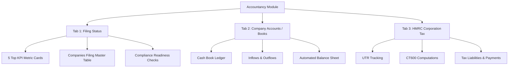

# 📊 Brixen CRM — Accountancy Module Architecture & Workflow Guide
**Source Files Analyzed:** `index.html` & `app.js` (Section: `#admin-accountancy`)

---

## 🎯 1. Module ka Maqsad (Core Purpose)
Accountancy module ka maqsad UK companies ke **Annual Accounts (Year-End Filings)**, **Companies House Compliance**, aur **HMRC Corporation Tax (CT600)** ko automate aur track karna hai:
- Har company ke accounts ki due date track karna.
- Year-end filing ke liye company ki compliance checking (Registered Office, IDV Verification, PSC Verification).
- Cash Book (Trial Balance) banana taake turnover aur profit/loss calculate ho sake.
- Companies House me official accounts submit karna (Micro-entity ya Dormant AA02).

---

## 📑 2. `#admin-accountancy` ke 3 Main Tabs (Inner Panes)

`index.html` aur `app.js` ke andar Accountancy module 3 primary tabs me divide hai:

---

### 🔹 Tab 1: Filing Status (Master Compliance Table)
Ye main dashboard hai jahan saari registered companies ka live status nazar aata hai:

#### A. Top 5 KPI Metric Cards:
1. **Overdue**: Wo companies jinki Companies House accounts due date nikal chuki hai.
2. **Due in 60 days**: Jinki due date agle 60 din ke andar anay wali hai.
3. **In progress**: Jinka accounting work start ho chuka hai lekin submit nahi hua.
4. **Issues**: Jin companies me compliance block hai (jaise address missing ya IDV pending).
5. **Filed**: Jinke accounts successfully file ho chuke hain.

#### B. Table Columns:
| Column Header | Description & Data |
| :--- | :--- |
| **Company** | Company Name + Company Registration Number (e.g. `15915437`). |
| **Owner** | Director / Client ka naam aur login email. |
| **Address** | Badge: `On file` (green) agar registered office set hai, warna `Missing` (red). |
| **IDV** | Director Identity Verification badge (`Verified` / `Not started` / `In progress`). |
| **PSC** | Persons with Significant Control verification status. |
| **Issues** | `Clear` agar 0 issues hain, ya `X block` (red) agar filing rokne wale issues hain. |
| **Year End** | Financial year closing date (Accounting Period End). |
| **Due Date** | Companies House ko accounts submit karne ki aakhri tareekh. |
| **Type** | Filing type: `Micro-entity`, `Dormant (AA02)`, ya `Full Accounts`. |
| **Status** | `Not started`, `In progress`, `Ready to file`, `Filed`, ya `Overdue`. |
| **Action Menu** | **View Books** (Trial Balance) aur **File Accounts** modal trigger. |

---

### 🔹 Tab 2: Company Accounts & Cash Book (`openAccountancyBooks`)
Ye company ke financial records aur balance sheet bananey ka workspace hai:
- **Cash Book Inflows**: Sales revenue, invoice receipts, owner funding.
- **Cash Book Outflows**: Cost of sales, staff costs, bank charges, operating expenses, VAT, dividends.
- **Trial Balance Calculator**:
  - **Turnover**: Total revenue collected.
  - **Net Profit**: Revenue minus total expenses.
  - **Current Assets**: Bank balance + debtors.
  - **Creditors**: Due within 1 year liabilities.
  - **Net Current Assets / Capital**: Balance Sheet final tally figure.

---

### 🔹 Tab 3: HMRC Corporation Tax (`CT600`)
- **UTR (Unique Taxpayer Reference)** number tracking for HMRC.
- Tax year calculation (12 months from financial start).
- Corporation tax liability estimation (19% - 25% CT rate).
- Payment tracking: `Pending Calculation`, `Payment Due`, ya `Nil Return Filed`.

---

## 🛠️ 3. Modals & Interactive Functions

### 1. `openFileAccountsModal(companyId)`
Jab user **"File Accounts"** button click karta hai:
1. **Company Selection**: Dropdown se registered company select hoti hai.
2. **Readiness Gate**: System check karta hai ke kya IDV, PSC, aur Address verified hain? Agar block hai toh warning display hoti hai.
3. **Period Selection**: `Accounting Start Date`, `Period End Date`, aur `Due Date` auto-fill hoti hain.
4. **Filing Type**: `Micro-entity` ya `Dormant (AA02)` choose kiya jata hai.
5. **Confirmation Code**: Submission reference number store hota hai.

### 2. `openAccountancyBooks(companyId)`
Jab user **"View Books"** click karta hai:
- Company ka digital ledger khulta hai.
- Admin nayi bank entry / invoice record add kar sakta hai (`Date`, `Category`, `Amount`, `In/Out`).
- Single-click se wahan se direct accounts file karne ka option milta hai (`fileAccountsFromBooks()`).

---

## 🔌 4. Backend REST API Endpoints

| Method | Endpoint | Description |
| :--- | :--- | :--- |
| `GET` | `/api/accountancy/filings` | Companies list, metrics counts (Overdue, Due soon, Issues, Filed) load karta hai. |
| `GET` | `/api/accountancy/company-accounts` | Balance sheets aur profit/loss statements data deta hai. |
| `GET` | `/api/accountancy/hmrc` | HMRC UTR aur Corporation Tax return data deta hai. |
| `POST` | `/api/admin/accountancy/:id/books` | Cash book me new entry add karta hai. |
| `DELETE`| `/api/admin/accountancy/:id/books/:entryId` | Cash book line item delete karta hai. |
| `POST` | `/api/admin/accountancy/:id/file` | Companies House accounts filing submit karta hai. |

---

## 💡 5. Frontend React vs Legacy Comparison
- **Legacy (`index.html` + `app.js`)**: Pure Vanilla JS DOM manipulation (`document.getElementById`, `innerHTML` string templates).
- **Modern React (`Accountancy.jsx`)**: TanStack `DataTable`, Shadcn UI `Badge` custom colors (`green`, `red`, `sky`, `purple`, `blue`), Shadcn `Card`, `Tabs`, `Dialog`, aur `SectionCards` ke sath fully reactive aur type-safe modular structure.
